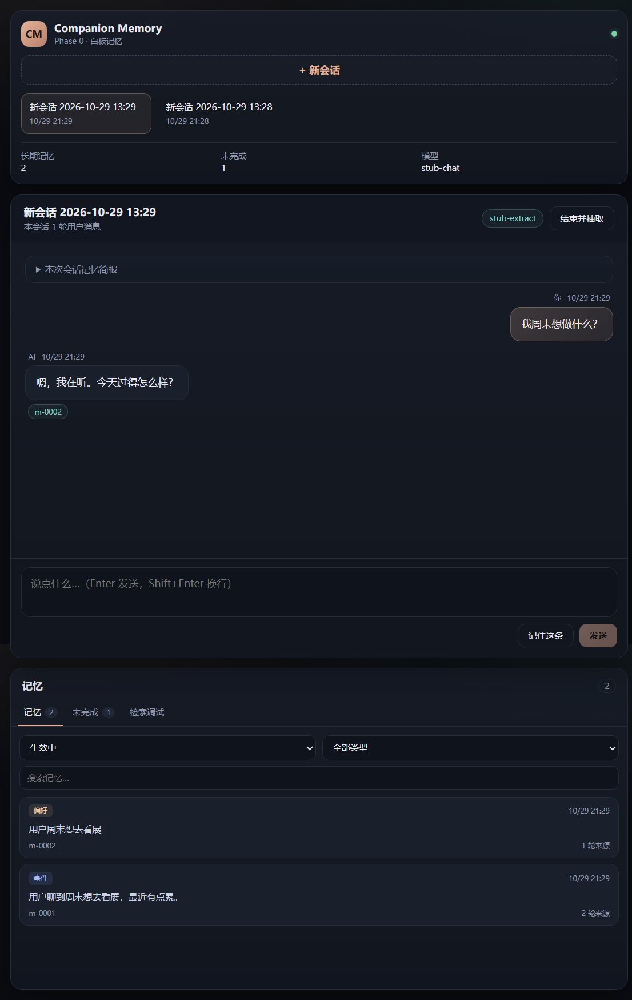

# Companion Memory · Phase 0（白板版）

一个**本地长期陪伴记忆**的最小闭环：Web 聊天 + SQLite 记忆 + 每轮检索注入 + 会话结束 LLM 抽取。

当前是 Phase 0：**白板记忆**，没有人设、没有蒸馏、没有向量检索、没有 QQ / 多用户。这些在后续阶段加。



> 截图是本地联调时用临时 stub 模型和测试数据拍的；正式使用时数据库从空白开始。

## 快速开始

要求：Node.js 24+、pnpm。

```bash
pnpm install

# Windows: copy .env.example .env
cp .env.example .env
# 编辑 .env，填入智谱开放平台的 LLM_API_KEY
# 默认模型：glm-4.7-flash（免费）；后期换 DeepSeek 只改这个文件

pnpm dev
```

打开终端里 Vite 输出的地址（默认 5173，被占用会自动 +1）。
生产模式：

```bash
pnpm build
pnpm start
# http://127.0.0.1:3210
```

> 没填 API Key 也能启动：聊天与抽取会提示未配置，但手动记忆、记忆浏览、检索调试可正常使用。

## 配置（`.env`）

| 变量 | 默认 | 说明 |
|---|---|---|
| `LLM_BASE_URL` | 智谱 v4 | OpenAI 兼容的 base URL |
| `LLM_API_KEY` | 空 | 必填；只放本地，不进仓库 |
| `LLM_CHAT_MODEL` | `glm-4.7-flash` | 聊天模型 |
| `LLM_EXTRACT_MODEL` | `glm-4.7-flash` | 抽取模型 |
| `LLM_EXTRACT_FALLBACK` | `glm-4-flash-250414` | 主抽取模型失败时的兜底 |
| `LLM_TIMEOUT_MS` | `60000` | 单次模型请求超时 |
| `DB_PATH` | `./data/companion.db` | SQLite 路径 |
| `PORT` | `3210` | API / 生产页面端口 |
| `EXTRACT_EVERY_TURNS` | `20` | 每 N 条用户消息自动抽取一次 |
| `RECALL_TOP_K` | `3` | 每轮注入的相关记忆条数 |
| `MEMORY_BLOCK_MAX_CHARS` | `1600` | 记忆块字符上限 |

换模型只改 `.env`，代码里没有写死模型名。

## 已实现

- **流式聊天**：SSE 逐字返回，前端实时显示。
- **会话简报**：新会话注入关系卡（tone 等）、未完成事项、最近 3 条事件、置顶记忆。
- **每轮检索**：FTS5 trigram 中文检索 + 时间新近 + 重要性 + 置顶加权，取 top 3；与简报重复的条目不重复注入。
- **手动记忆**：右下角“记住这条”，支持类型、置顶；包含关系自动去重。
- **LLM 抽取**：会话结束或每 20 轮，抽取 episode / fact / open loop / relationship tone；强制每条事实带来源轮次；JSON 校验 + 一次修复重试 + 模型兜底。
- **记忆管理**：列表、类型/状态筛选、搜索、详情、来源对话、置顶、归档、恢复、彻底删除。
- **未完成事项**：列表、关闭、手动添加。
- **检索调试**：输入一句话看候选、BM25/新近/重要性/排序分，以及最终拼装出的 `<companion-memory>` 注入块。
- **本地存储**：SQLite（WAL + FTS5），单文件备份；空库启动，无预置数据。

## 怎么验证

1. 新建会话，聊一句：“最近有点累，周末想去看展”。
2. 点“结束并抽取”。记忆面板应出现 1 条事件 + 1 条偏好，未完成里出现“周末去看展”，关系卡出现 tone。
3. 再新建会话，打开“本次会话记忆简报”，应看到未完成事项和最近事件。
4. 问：“我周末想做什么？” 发送中的气泡下方应出现相关记忆 chip（例如 `m-0002`）。
5. 打开“检索调试”，输入同一句话，能看到候选与得分；点“查看拼装后的注入块”核对格式。
6. 在详情里归档一条记忆，再回到检索调试，确认它不再出现；恢复后重新出现。

## 数据与隐私

- 数据在 `data/companion.db`，纯本地；`data/`、`.env` 都在 `.gitignore` 里。
- SQLite 是二进制，不能直接用 Obsidian 打开；需要阅读时可以做 Markdown 导出（Phase 2）。
- 聊天和抽取会把相关文本发送到 `.env` 里配置的模型 API；介意的话换成本地 Ollama。
- 默认明文本地存储；没有加密，没有账号体系。

## 结构

```
src/
  core/
    db.ts        SQLite schema / FTS5 / WAL / 事务
    store.ts     会话、消息、记忆、未完成事项、关系卡
    retrieve.ts  trigram 分词、FTS5 检索、打分
    inject.ts    会话简报、记忆块、系统提示词
    extract.ts   LLM 抽取 + zod 校验 + 来源校验 + 入库
    llm.ts       OpenAI 兼容客户端（流式 / JSON）
  server/
    index.ts     Fastify 路由 + SSE 聊天
  web/
    App.tsx      聊天 / 记忆 / 未完成 / 检索调试
    api.ts       前端 API 封装
    styles.css   深色界面
tests/
  store.test.ts  检索、注入、归档、去重、会话计数
```

## 测试

```bash
pnpm typecheck
pnpm test
pnpm build
```

当前 8 个单元测试全部通过；构建产物在 `dist/web`。

## 验证记录（2026-10-29）

- `pnpm typecheck`、`pnpm test`（8 项）、`pnpm build` 全部通过。
- 浏览器里实际验证过：新建会话、流式聊天、注入 chip、结束并抽取、新会话简报、手动记忆、置顶/归档/恢复、检索调试、注入块预览。
- 流式聊天与抽取是用**临时本地 stub 模型**验证的；没有真实智谱 Key，所以**没有跑过真实 API**。填好 `.env` 后按上面「怎么验证」走一遍即可确认。

## Phase 0 明确不做

- 人设 / 人设蒸馏（下一阶段）
- 向量检索 / embedding（先用 FTS5）
- 夜间定时巩固 / 章节摘要（目前只有会话结束抽取）
- 冲突裁决 UI（数据库有 status 字段，界面未做）
- 多用户 / QQ 官方 Bot 适配（schema 里已预留 `person_id`）
- 记忆导出 Markdown / Obsidian

## 下一步

Phase 1：补关系卡编辑、冲突裁决、每晚巩固与章节摘要、20–30 条记忆探针评测。
Phase 2：SQLite + 向量混合检索、QQ 官方 Bot、多用户隔离。
