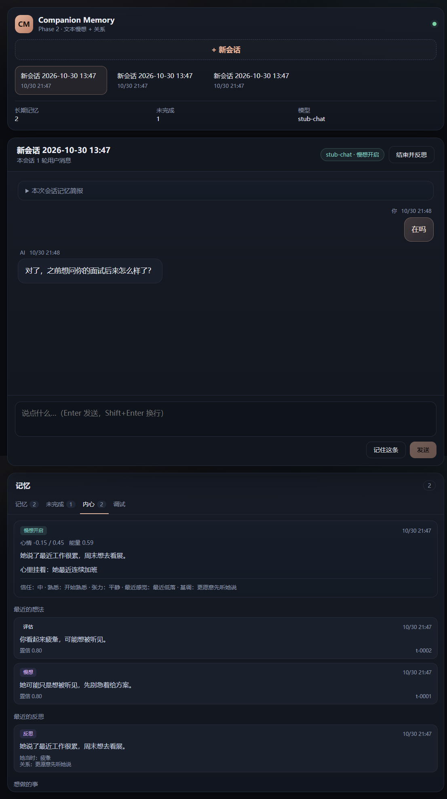

# Companion Memory · Phase 2（文本慢想 + 关系）

一个**本地长期陪伴记忆 + 认知循环**的 Web 应用：聊天 + SQLite 记忆 + 每轮检索注入 + 慢想路由 + 会话反思 + 关系状态 + 到期意图 follow-up。

当前是 Phase 2：**纯文本优先**；多模态只预留接口（见 [DESIGN.md](DESIGN.md) 13.5），QQ / 多用户推迟。



> 截图是本地联调时用临时 stub 模型和测试数据拍的；正式使用时数据库从空白开始。

## 快速开始

要求：Node.js 24+、pnpm。

```bash
pnpm install

# Windows: copy .env.example .env
cp .env.example .env
# 编辑 .env，填入智谱开放平台的 LLM_API_KEY
# 默认模型：glm-4.7-flash（免费）；后期换 DeepSeek 只改这个文件

pnpm dev
```

打开终端里 Vite 输出的地址（默认 5173，被占用会自动 +1）。
生产模式：

```bash
pnpm build
pnpm start
# http://127.0.0.1:3210
```

> 没填 API Key 也能启动：聊天与反思会提示未配置，但手动记忆、记忆浏览、检索调试可正常使用。

## 配置（`.env`）

| 变量 | 默认 | 说明 |
|---|---|---|
| `LLM_BASE_URL` | 智谱 v4 | OpenAI 兼容的 base URL |
| `LLM_API_KEY` | 空 | 必填；只放本地，不进仓库 |
| `LLM_CHAT_MODEL` | `glm-4.7-flash` | 聊天模型 |
| `LLM_EXTRACT_MODEL` | `glm-4.7-flash` | 抽取模型 |
| `LLM_EXTRACT_FALLBACK` | `glm-4-flash-250414` | 主抽取模型失败时的兜底 |
| `LLM_TIMEOUT_MS` | `60000` | 单次模型请求超时 |
| `MIND_MODE` | `shadow` | `off` 关闭 / `shadow` 后台慢想不影响回复 / `on` 慢想参与回复 |
| `MIND_MODEL` | `glm-4.7-flash` | 斟酌与反思用的模型 |
| `DB_PATH` | `./data/companion.db` | SQLite 路径 |
| `PORT` | `3210` | API / 生产页面端口 |
| `EXTRACT_EVERY_TURNS` | `20` | 每 N 条用户消息自动反思一次 |
| `RECALL_TOP_K` | `3` | 每轮注入的相关记忆条数 |
| `MEMORY_BLOCK_MAX_CHARS` | `1600` | 记忆块字符上限 |

换模型只改 `.env`，代码里没有写死模型名。

## 已实现

- **流式聊天**：SSE 逐字返回，前端实时显示。
- **会话简报**：新会话注入关系卡（tone 等）、未完成事项、最近 3 条事件、置顶记忆。
- **每轮检索**：FTS5 trigram 中文检索 + 时间新近 + 重要性 + 情绪 + 显式强化 + 置顶加权，取 top 3；与简报重复的条目不重复注入。
- **慢想路由**：情绪、负向、关系/记忆线索、冲突、决定、边界、歧义会触发慢路径；闲聊走快路径。
- **隐藏斟酌**：慢路径先让模型做“2–3 种解释 → 2–3 种回应 → 选一种”，只把一句 thought_summary 落库，不保存 raw CoT。
- **`shadow` / `on` 模式**：`shadow` 后台试跑、不影响回复；`on` 把斟酌结论注入回复；`off` 保持原行为。
- **会话反思**：结束或每 20 轮，抽取事实后生成反思（发生了什么、用户状态、我的状态、关系变化、未解决、下次意图），并更新 `mind_state`。
- **内心面板**：显示心情/能量/关注点、最近想法、最近反思、主动意图、路由预览。
- **关系状态**：信任 / 熟悉 / 张力 / 最近感觉，由反思小幅更新；用文字而不是好感度分数展示。
- **情绪评估**：每轮慢想记录“她感觉到的你”，轻微影响她的心情；不把一次情绪写成永久人格。
- **到期 follow-up**：意图到期后，新会话顶部出现“想问你”卡片；你开口时她自然提起，每天最多一次，不单独推送。
- **显式强化**：检索只读；记忆详情里的“确认重要”才增加强化次数，避免“查得越多越难忘”。
- **手动记忆**：右下角“记住这条”，支持类型、置顶；包含关系自动去重。
- **记忆管理**：列表、类型/状态筛选、搜索、详情、来源对话、置顶、归档、恢复、彻底删除。
- **未完成事项**：列表、关闭、手动添加。
- **检索调试**：输入一句话看候选、相关度/新近/重要性/情绪/排序分，以及最终拼装出的 `<companion-memory>` 注入块。
- **本地存储**：SQLite（WAL + FTS5），单文件备份；空库启动，无预置数据。

## 慢想是怎么工作的

```
消息 → 感知（意图/情绪/歧义）→ 快慢路由
  ├─ 快：检索 → 直接回复
  └─ 慢：检索 → 斟酌（JSON 计划）→ 回复
                                      ↓
                              写 thought_summary
                                      ↓
                        结束/每 20 轮 → 反思 → 更新关系/心情/意图
```

默认 `MIND_MODE=shadow`：慢路径在后台跑并留下摘要，但回复仍走快路径。想看她真的用上斟酌，改成 `MIND_MODE=on` 后重启。

## 怎么验证

1. 把 `MIND_MODE` 设为 `on`，重启后新建会话，聊：“最近工作很累，周末想去看展”。
2. 回复过程中应出现“慢想：先接情绪，再问一句……”的标记；聊天走的是斟酌后的方向，并出现“她感觉到：疲惫”。
3. 点“结束并反思”。记忆面板出现事件/偏好，未完成出现“周末去看展”，关系卡出现 tone；内心出现思考摘要、反思、主动意图，关系状态小幅变化。
4. 再新建会话，打开“本次会话记忆简报”，应看到关系状态、未完成事项和最近事件。
5. 如果上一步生成了到期意图，新会话顶部会出现“想问你”卡片；你开口后她会自然追问，之后当天不再重复。
6. 问：“我周末想做什么？” 气泡下方应出现相关记忆 chip（例如 `m-0002`）。
7. 打开“检索调试”，输入同一句话，能看到相关度/新近/重要性/情绪；点“查看拼装后的注入块”核对格式。
8. 在记忆详情点“确认重要”，强化次数 +1；再归档一条记忆，检索调试里确认它不再出现，恢复后重新出现。
9. 在“内心 → 路由预览”输入“你好呀”应显示快速回应，输入“我今天真的很累”应显示会慢想。

## 数据与隐私

- 数据在 `data/companion.db`，纯本地；`data/`、`.env` 都在 `.gitignore` 里。
- SQLite 是二进制，不能直接用 Obsidian 打开；需要阅读时可以做 Markdown 导出（后续阶段）。
- 聊天、慢想、抽取/反思会把相关文本发送到 `.env` 里配置的模型 API；介意的话换成本地 Ollama。
- `thought` 只存摘要，不存 raw chain-of-thought；默认 7 天过期。
- 默认明文本地存储；没有加密，没有账号体系。

## 结构

```
src/
  core/
    db.ts        SQLite schema / FTS5 / WAL / 迁移
    store.ts     会话、消息、记忆、未完成、关系、mind_state/thought/reflection/intention
    retrieve.ts  trigram 分词、FTS5 检索、情绪/强化打分
    inject.ts    会话简报、记忆块、系统提示词
    extract.ts   LLM 抽取 + zod 校验 + 来源校验 + 入库
    llm.ts       OpenAI 兼容客户端（流式 / JSON）
  mind/
    perceive.ts  感知 + 快慢路由
    deliberate.ts 隐藏斟酌（JSON 计划）
    appraise.ts  情绪评估 + 心情混合
    express.ts   把斟酌结论/到期意图拼进系统提示词
    reflect.ts   会话反思 + 关系数值/心情/意图更新
    thoughts.ts  记录 thought_summary / appraisal
  server/
    index.ts     Fastify 路由 + SSE 聊天
  web/
    App.tsx      聊天 / 记忆 / 未完成 / 内心 / 调试
    api.ts       前端 API 封装
    styles.css   深色界面
tests/
  store.test.ts  检索、注入、归档、去重、会话计数
  mind.test.ts   强化、mind_state、关系状态、appraisal、意图到期、路由
```

## 测试

```bash
pnpm typecheck
pnpm test
pnpm build
```

当前 18 个单元测试全部通过；构建产物在 `dist/web`。

## 验证记录（2026-10-30）

- `pnpm typecheck`、`pnpm test`（18 项）、`pnpm build` 全部通过。
- 浏览器里实际验证过：新建会话、流式聊天、慢想标记、情绪评估、关系状态、到期 follow-up 卡片、结束并反思、内心面板、意图完成、路由预览、确认重要、归档/恢复、检索调试、注入块预览。
- 慢想/反思/follow-up 是用**临时本地 stub 模型**验证的，覆盖 `MIND_MODE=on` 与 `shadow` 两条路径；真实智谱 API 没有跑过。填好 `.env` 后按上面「怎么验证」走一遍即可确认。

## Phase 2 明确不做

- 人设 / 人设蒸馏（后续）
- 向量检索 / embedding（先用 FTS5）
- 夜间定时巩固 / 衰减归档（Phase 3）
- 冲突裁决 UI（数据库有 status 字段，界面未做）
- 多模态上传 / ASR / TTS（只预留接口，见 DESIGN.md 13.5）
- 多用户 / QQ 官方 Bot（推迟）
- 记忆导出 Markdown / Obsidian

## 下一步

完整设计见 [DESIGN.md](DESIGN.md)（慢思认知循环）；Phase 0 的历史设计见 [docs/PHASE0-DESIGN.md](docs/PHASE0-DESIGN.md)。

- Phase 3：夜间巩固 + 衰减归档 + 1 跳联想 + 元认知。
- Phase 4：Web 文本版收尾 + 评测。
- 预留：多模态（见 DESIGN.md 13.5）；QQ 与多用户推迟。
